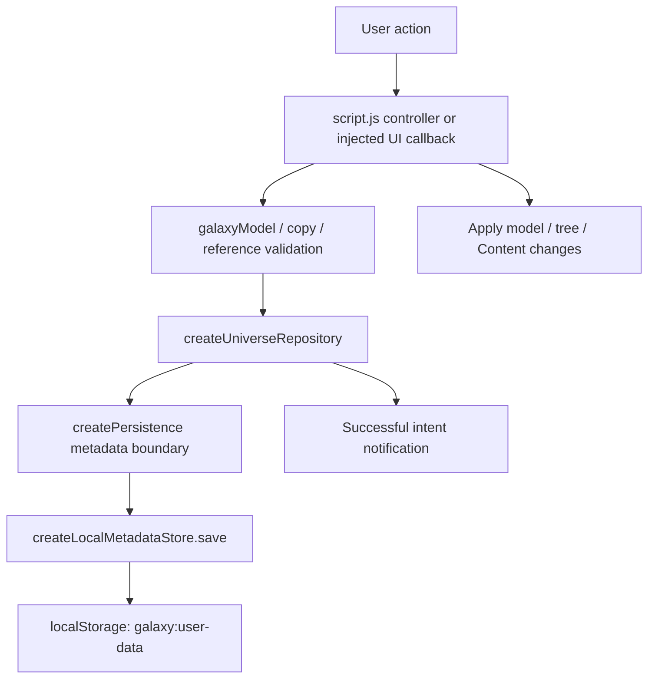

# Cosmifold cloud foundation: audit and incremental migration plan

Audit date: October 11, 2026. Branch: `architecture/cloud-foundation`.

Subsequent implementation checkpoint: Auth has been verified by the user locally
and in production, and the cloud metadata SQL migration is installed with its
private schema unexposed. [Step 4](cloud-metadata-gateway.md) adds shared client
ownership and an explicit, validated RPC gateway plus a manual local HTTP
diagnostic. The user reports that its live authenticated list/create/read and
anonymous-denial checks passed, with revision `0`, no local metadata upload,
and exactly one row returned by guarded cleanup of the disposable Universe.
Step 4 is ready to commit; commit/receipt HTTP behavior, second-owner HTTP
isolation, private-table/GraphQL HTTP probes and concurrent locking remain
integration gaps. Cloud mode is still inactive; all current Cosmos metadata/files stay
browser-local. Repository commands, cache/bootstrap, local-data migration and
sync remain separate gates. The audit observations below retain their original
date/scope.

This is a design document, not an implementation. Repository observations below describe the current checked-out code. Proposed tables, interfaces, branches and deployment settings describe future work. No provider account, connection, credential, package, migration or deployment is part of this audit.

## 1. Plain-language summary

Keep Cosmifold. Its interface, organization rules, rendering and physics do not need a framework rewrite to become an online product.

Today the browser keeps one large record of the Cosmos, and keeps the actual files separately. Hosting those application files on a website will make Cosmifold accessible online, but will not make a user's data follow them to another device. Accounts, a shared database and private file storage are separate milestones.

Recommend **the existing HTML/CSS/JavaScript frontend, Cloudflare Pages hosting, and Supabase Auth + PostgreSQL + private Storage**. Start with email/password. Keep one private Cosmos per account initially, while allowing the underlying model to support additional universes later.

The current repository is a useful starting point, not a ready-made cloud plugin. It assumes metadata saves finish immediately. Files also rely on a local transaction callback that cannot be reproduced across a network. Add an awaitable application boundary while preserving the existing local transaction implementation, then introduce remote operations behind that boundary.

The first cloud release should save ordinary actions automatically, use a server revision to reject stale writes, and load the latest data on opening/reconnecting. It should not silently overwrite another device's work. Keep a private local cache for reading during outages; defer unrestricted offline editing and merging.

Protect existing local data before accounts become a default. Build portable backup/restore early, stage local imports with their files, and keep the original local Cosmos untouched. Cloud metadata alone is not a finished product when its attachments still exist only on one laptop.

**Next implementation branch: `chore/static-hosting-foundation`.** Prepare static-root checks and a staged Cloudflare Pages GitHub-integration plan using `main`, retaining local persistence. Connecting/deploying and later enabling automatic production pushes are separately authorized steps. Section 14 gives its exact boundaries.

## 2. Current architecture

### Application entry and composition

[index.html](../index.html) supplies the canvas layers, sidebar, Content panel, forms and native dialogs. Its ordered classic script tags load shared globals; this is not an ES-module or framework application. [style.css](../style.css) owns desktop/mobile presentation. The only vendored runtime dependency is the existing D3 force bundle under `vendor/`; there is no package/build manifest in this checkout.

[script.js](../script.js) is the composition root and application controller. It creates `persistence`, `universeRepository`, `HierarchySidebar`, `GraphCamera`, `GalaxyPhysics`, the content inspector/viewer, collection UI and interactions. It holds active `entries`, `archivedEntries`, `portals`, `constellations`, `layout`, `archivedGalaxies`, selection/navigation state and DOM maps. `initializeGalaxy()` loads and projects persisted data. Large portions of DOM rendering and mutation orchestration still live here.

[config.js](../config.js) declares `environment: 'local'`, `persistenceMode: 'local'`, `workspaceId: null`, `auth: 'none'`, `sync: 'none'`. Currently `createPersistence()` uses `workspaceId` as a namespace and `sample`/injected adapters for selection. The other fields do not implement authentication, cloud routing or synchronization.

### Modules and actual responsibilities

| Modules | Observed responsibilities and boundaries |
| --- | --- |
| [model.js](../model.js), `galaxyModel` | Entry/content/Location normalization, file classification, canonical `parentId` traversal, derived roles/depth, legacy migration, layout conversion, move/deletion validation and name-only Search. No persistence API calls. |
| [hierarchy.js](../hierarchy.js) | `HierarchySelection` and `HierarchySidebar` maintain sidebar selection, tree projection, rename, move drag and navigation callbacks. `NavigationSection` and sidebar sizing write injected UI preferences. |
| [clipboard.js](../clipboard.js) | `HierarchyClipboard` is page-local; `hierarchyCopies.prepare/plan/structure` build canonical copy plans, independent IDs and remapped parents. Content copy and structure-only copy are deliberately different. |
| [portals.js](../portals.js), [constellations.js](../constellations.js), [archives.js](../archives.js) | Normalize reference placements and collections; clean references on deletion; split/join archived canonical entries. Archive motion is presentation only. |
| [constellations-ui.js](../constellations-ui.js), [item-picker.js](../item-picker.js) | Collection management, staged selection and canonical item picking. Persistence/navigation are injected callbacks, but commits are currently synchronous. |
| [rich-content.js](../rich-content.js) | `EntryContentInspector` displays/edits Notes, Bookmarks, Location and attachments, calls injected metadata save functions and file-store methods, manages async jobs and preview lifetimes. |
| [attachment-store.js](../attachment-store.js) | Despite the filename, `galaxyAttachmentFiles.prepare()` validates and creates metadata, Blob records and thumbnails. It does **not** open IndexedDB. |
| [image-viewer.js](../image-viewer.js) | `CosmifoldImageViewer` reads the injected store, creates transient Blob URLs and presents images/videos/PDFs. |
| [everyday.js](../everyday.js) | Starter structures, checklist text operations, URL/file drops and sidebar spring-open behavior. Drops invoke the existing content path. |
| [physics.js](../physics.js), [camera.js](../camera.js) | `GalaxyPhysics.setGraph()` consumes a projected tree and placements; `GraphCamera` controls view/travel. Neither is an account or database layer. |
| [appearance.js](../appearance.js), [cosmos-view.js](../cosmos-view.js), [label-density.js](../label-density.js), [motion.js](../motion.js), [background.js](../background.js) | Deterministic body appearance, visibility/detail rules, bounded labels, animation and background rendering. Preserve these algorithms. |
| [help.js](../help.js) | Informational native modal/disclosures and keyboard/focus handling. No data writes. |
| [sample-data.js](../sample-data.js) | Disposable sample records/files. `?sample=large` selects in-memory adapters for that page load. Returning to the ordinary page reloads the real local universe. |
| [services/universe-repository.js](../services/universe-repository.js) | Snapshot and compound-operation boundary: content, Location, collections, placements, moves, copy, structure duplication, archive/restore and deletion. |
| [persistence/composition.js](../persistence/composition.js) and adapters | Store selection, namespacing, errors and local transaction contracts; detailed below. |

Runtime references are not database records. DOM elements, particles, camera transforms, selected rows, active collection lens, search results, Help disclosure state, drafts and clipboard state are not serialized as canonical content.

## 3. Current persistence and data flow

### Metadata flow



This is the common path, but publication order differs by action. Do not assume every workflow already persists before touching live state.

| User action | Actual path | Publication/persistence behavior |
| --- | --- | --- |
| Startup/reload | `initializeGalaxy()` -> `universeRepository.load()` -> metadata `load()` -> JSON parse -> model/reference/archive normalization | Synchronous read; invalid saved data enables recovery protection rather than silently overwriting it. Legacy/new-local startup can schedule a canonical save. |
| New item / starter / form reparent | Entry-form submit -> `commitCrudMutation()` -> mutate live entries, derive hierarchy/physics -> `saveGalaxy()` -> repository `save()` | Live model changes first. `saveGalaxy()` catches errors; a failed save can leave session-only edits visible. This differs from the stronger repository-first paths below. |
| Rename | `renameEntry()` -> repository `save()` -> `commitCrudMutation(..., persisted:true)` | Saves first; failure throws before applying the name. |
| Notes / checklist / Bookmark | `EntryContentInspector` -> `saveEntryContent()` -> repository `updateContent()` -> `save()` | Whole snapshot save, then updates canonical entry content/timestamp. Notes are plain text, not HTML. |
| Location | inspector `saveLocation` -> `saveEntryLocation()` -> repository `updateLocation()` | Optional canonical `{text}`; saves before updating runtime data. Removal deletes only this property. |
| Group move | sidebar `onMove` -> `moveSidebarEntries()` -> repository `moveEntries()` -> model `movePlan()` | Effective roots validated; one save precedes UI publication; moved roots lose obsolete layout influences. |
| Copy -> Make a copy | `confirmHierarchyPaste('copy')` -> repository `copyEntries()` -> `hierarchyCopies.plan()` -> file batch if needed -> metadata write | Fresh entry/Bookmark/attachment/internal-placement IDs; validates the live source again after async file reads. UI publication follows completed batch. |
| Duplicate structure | structure form -> repository `duplicateStructure()` -> `hierarchyCopies.structure()` -> `save()` | New IDs, names and canonical parents only. No content, Location, memberships, placements or file I/O. |
| Link existing / remove placement | `commitPortalReferences()` -> `replacePlacements()` -> `save()` | Saves references, then updates sidebar. `openPortal()` navigates to the target canonical item; there is no second content/Location owner. |
| Constellation changes | `ConstellationWorkspace.commit` -> `commitConstellations()` -> `replaceConstellations()` | Membership is a list of canonical IDs. Saves before publishing collection changes. |
| Archive / restore | archive form or `restoreGalaxy()` -> repository `archive/restore()` | Archive record is additive metadata; active/archived maps are projections of the same stored entries, not copied data. |
| Delete subtree | delete form -> repository `deleteSubtree()` -> file-store `deleteEntries()` if required -> metadata commit | Removes canonical entries, placements touching them, membership references, archive records and layout records. Publishes after success. |
| Body drag / automatic settling | `physics.endDrag()` / physics callbacks -> `layout`, `entry.x/y`, `graphNeedsSave` -> `saveGalaxy()` | Manual preferences and automatically recomputed world coordinates currently share snapshot persistence. Saves also occur on `pagehide`/hidden visibility. |
| Sidebar preferences | `HierarchySidebar.savePreference()`, `NavigationSection.setCollapsed()`, `ConstellationWorkspace.saveSectionPreference()` -> injected preferences `update()` | Bypasses domain repository intentionally; best-effort local preference write. |

`getGalaxySnapshot()` calls repository `snapshot()` with `allCanonicalEntries()`, joining archived and active entries. Persisting only the visible `entries` map would lose archived content.

### Exactly what lives where

| Data | Current persistence location |
| --- | --- |
| Galaxies and all other canonical items | Main snapshot `entries[]`; a Galaxy is a root with `parentId:null`, not a separate entity/table. |
| Names, parents, description/category, appearance overrides | Fields of each canonical entry. |
| Notes and Bookmarks | Optional `entry.content`, with plain text notes and ordered `links[]`. Bookmark IDs/URLs/titles are metadata, not remote fetched pages. |
| Location | Optional `entry.location: {text}`. The Google Maps link is constructed on demand, not persisted as a Bookmark or file. |
| Files and Media metadata | `entry.content.attachments[]`; Media is a classified display of attachments, not a separate storage collection. |
| Original bytes and thumbnails | IndexedDB `galaxy-attachments`, database version **1**, object store `files`, key path `key`, nonunique `entryId` index. |
| Constellations | Main snapshot `constellations[]` with `memberEntryIds[]`. Geometry/MST overlay is calculated, not stored. |
| Linked appearances | Main snapshot `portals[]`: `id`, `targetEntryId`, `parentEntryId`, `createdAt`. UI calls them linked items. |
| Archived state | Main snapshot `archivedGalaxies[]`: root ID, archive time and optional remembered `expandedIds`. The entries/content/files remain in the same stores. |
| User body placements | Main snapshot `layout[]`: parent-relative `angle`/`radius` associated with an entry and parent. |
| World coordinates | Entry `x/y`; old layout formats may also contain coordinates that `normalizeLayout()` converts. |
| Sidebar sizing/disclosure preferences | Separate localStorage `galaxy:navigation-ui`: `collapsed`, `width`, `universeCollapsed`, `constellationsCollapsed`, `constellationsSeen`, `archivedCollapsed`. |
| Legacy recovery backups | Exact raw localStorage values at `galaxy:user-data:pre-hierarchy`, `:pre-layout`, `:pre-cosmic-tree`, where applicable. Not file backups. |
| Selection, search text/results, camera state, ordinary branch expansion, drafts, clipboard, preview URLs, animation and Help state | In-memory/page state. Archive expansion restoration is the narrow stored exception. |
| Sample data and preferences | Memory adapters; sample files are memory Blob records. Repository intent publication is suppressed for Sample. |

Scoped metadata/preferences keys are `galaxy:workspace:<encodeURIComponent(scope)>:user-data` and `...:navigation-ui`; scoped file DB is `galaxy-attachments:<encodeURIComponent(scope)>`. Legacy metadata fallback is `tool-galaxy:user-data` only for the unscoped store. **A namespace is not authentication or authorization.**

No production `sessionStorage`, `fetch`, WebSocket, BroadcastChannel, service-worker or storage-event sync path was found in the application modules. Test fixtures do use sessionStorage. Bookmark/Maps navigation is user initiated; generated artwork and previews use transient Blob URLs.

### What storage v5 means

`createLocalMetadataStore.save()` writes this envelope, with version **at the top level**:

```text
{
  version: 5,
  entries: [
    {
      id, name, description, category, parentId, x, y,
      appearance?, createdAt?, updatedAt?,
      location?: {text},
      content?: {
        version: 1,
        notes: {format: "plain", text},
        links: [{id, url, title?}],
        attachments: [{
          id, kind: "upload", entryId, storageKey,
          filename, mimeType, size, createdAt,
          extension?, duration?, width?, height?
        }]
      }
    }
  ],
  connections: [],
  layout: [{id, parentId, angle, radius}],
  portals?: [{id, targetEntryId, parentEntryId, createdAt}],
  constellations?: [{id, name, memberEntryIds, createdAt, updatedAt?}],
  archivedGalaxies?: [{galaxyId, archivedAt, expandedIds?}]
}
```

This is illustrative notation, not executable JSON. `connections:[]` is an empty legacy compatibility slot; it is not an active relationship feature. Repository snapshots omit the envelope version; the local adapter adds it. Content version 1 and IndexedDB version 1 are independent of metadata version 5.

The v5 envelope requires arrays for entries/layout. Optional reference/archive arrays default to empty at startup. Content, Location, appearance and valid timestamps are optional. Older entries can omit description/category/coordinates and receive model defaults. Present content must satisfy the content validator; width/height are retained as a valid positive pair. A malformed optional Location is omitted by normalization, rather than rejecting the entire otherwise valid entry.

Versions 1–5 are accepted by the metadata adapter. V1 reads `tools`; v1/v2 combine partial entries and `builtInPositions` with initial records. Before v3 is replaced, the exact previous value is backed up under `pre-hierarchy`; v3 gets `pre-layout`; any pre-v5 snapshot gets `pre-cosmic-tree`. `initializeGalaxy()` uses `migrateLegacy()` for pre-v5 data: a generic Galaxy root wraps valid old relationships, then hierarchy roles/depth are derived. `normalizeLayout()` converts historical coordinates/pins into supported relative influences; obsolete flags and relationships are removed from active state. Invalid/future envelopes, invalid content and corrupt archive records trigger preservation/recovery behavior. Backups remain when ordinary metadata `clear()` runs.

Runtime uses Maps and derived role/depth/physics data; serialization uses arrays and an explicit allowlist. This is a good separation. It is also an integration hazard: a new persisted field must survive both `normalizeEntry()` and repository `snapshot()`, as Location already demonstrates. Validators can repair/drop information; cloud ingestion must validate before publishing, not silently treat a repaired tree as an authorized deletion or move.

Entry-array/Map insertion order drives canonical sibling order. There is no explicit reorder feature or persisted sibling rank today. SQL reads without an explicit order would change this behavior; import must retain order, and cloud projection must sort explicitly.

### Full attachment path

```text
File picker / drop
  -> EntryContentInspector.upload(files)
  -> galaxyAttachmentFiles.prepare(file, canonicalEntryId)
       metadata: UUID id; storageKey=id; entryId=owner item
       record: {key:id, entryId, blob:Blob, thumbnail?:Blob}
  -> persistence.files.save(record, synchronousCommit, rollback)
  -> createIndexedDbFileStore transaction("readwrite")
       files.put(record)
       -> saveEntryContent -> updateContent -> localStorage snapshot
       -> IndexedDB transaction completes
  -> visible lists/previews refresh
```

Preparation blocks executable/script/installer extensions and MIME types, permits generic attachments with safe MIME fallback, checks sizes, validates PDF signatures and validates/decode-limits supported images. Current limits: 10 MiB ordinary files, 100 MiB video, 20 megapixels image preview, 240-pixel thumbnail edge, 2,048-byte text preview; Notes allow 100,000 characters. Video duration/frame extraction is best-effort. Thumbnail bytes live in the file record; dimensions/duration live in metadata.

`EntryContentInspector.preview()` and viewer filmstrip/display read `store.get(storageKey)`, check `record.entryId` against metadata ownership and use Blob URLs. Generation/session guards stop late async reads from updating the wrong selection. Images/videos use saved thumbnails; supported text previews use a bounded slice. Generic files use a details dialog and `downloadFile()` creates an `application/octet-stream` Blob plus download attribute. Supported media/PDFs use the internal viewer; text opens a detached new tab. Do not replace inert generic download with navigation to uploaded HTML/SVG on the app origin.

Single attachment removal calls `store.delete(key, commit, rollback)` after the existing lightweight confirmation. Subtree removal uses the `entryId` index and can also remove unreferenced records. `hasEntries()` conservatively returns true until its startup key-only ownership discovery finishes. Archive does not delete bytes. Removing a linked placement does not delete the canonical file.

Normal copy allocates fresh attachment IDs/storage keys, reads source Blob/thumbnail records, checks ownership/size, and saves copied records in one `saveBatch()`. A copied item owns independent records, even if immutable Blob values can be reused in memory. Copy includes only wholly internal linked placements; it does not copy Constellation membership. Structure duplication invokes no binary store.

**Atomicity limit:** localStorage is not inside the IndexedDB transaction. The store calls synchronous metadata commit and compensates on a later IndexedDB abort. This handles tested failures, but it is not one cross-store ACID transaction: browser termination between writes, or failed compensation, can leave inconsistency. Tests exercise quota/abort/recovery, not a proof of crash-proof distributed transactions. Never describe cloud database and object storage as one atomic transaction either.

## 4. Local-only assumptions and repository readiness

### Concrete risk register

Risk here means migration/data-integrity risk, not a judgment that a local feature is defective. This table records the original pre-refactor audit. Phase 4 now implements awaited semantic commands and safe publication; see [the current persistence contract](persistence-contract.md) for the resolved command-boundary risks and intentional local-only exceptions.

| Rank | Assumption / code reference | Cloud implication and required response |
| --- | --- | --- |
| **High** | `persistence/composition.js`, `boundary()`: rejects thenable metadata returns. `tests/persistence.test.js`: async-only adapters explicitly fail. | A remote metadata adapter is incompatible. Introduce a separate async public repository contract, not a Promise disguised as a local adapter. |
| **High** | `script.js`, `initializeGalaxy()`, `saveEntryContent()`, `saveEntryLocation()`, `renameEntry()`, `commitConstellations()`, `commitPortalReferences()` read/save immediately. | Await authenticated bootstrap and commands; handle pending, failure and expired sessions. Publish acknowledged state deliberately. |
| **High** | `script.js`, `commitCrudMutation()` mutates live Maps/physics before `saveGalaxy()`; `saveGalaxy()` catches errors. | Creation/form reparent can look successful after failed persistence. Plan immutable domain changes first, persist, then use existing UI publication. Preserve recoverable drafts. |
| **High** | `createUniverseRepository.save()` replaces the whole snapshot; local adapter `setItem()` has no revision. No storage-event/BroadcastChannel consumer. | Even two local tabs can overwrite each other. Cloud writes need server compare-and-swap and serialized commands before cross-device release. |
| **High** | `indexeddb-file-store.js`, `transaction()/finish()` and inspector `upload()` require synchronous metadata callbacks; repository copy/delete use compensation snapshots. | Remote upload/delete/copy need explicit staged lifecycle and retry cleanup. Never restore an old whole cloud snapshot as compensation for a file failure. |
| **High** | `config.js`; repository `canWrite` only checks local availability/Sample. Records/files contain no authenticated owner. | Server-enforced ownership, RLS, same-universe foreign keys and account-isolated caches are mandatory; UI filtering is insufficient. |
| **High** | Physics callbacks in `script.js` overwrite entry `x/y` and set `graphNeedsSave`; settle/pagehide call `saveGalaxy()`. | Automatic layout would generate needless network writes/conflicts. Separate semantic edits, explicit layout intent and local coordinate checkpoints at the controller/persistence boundary. |
| **High** | `initializeGalaxy()` interprets null/no snapshot as legacy/new local data and may seed/migrate initial entries. | Auth/network failure must not look like a new empty account. Explicit loading/error/empty-cloud states; a fresh cloud universe is an intentional validated empty v5 projection. |
| **Medium** | Snapshot/reference arrays, `childrenOf()`, `HierarchySidebar` index preserve insertion order. | SQL must have stable explicit ordinals; do not implement drag reorder merely to solve serialization order. |
| **Medium** | `rich-content.js` and `image-viewer.js`: `get()` expects Blob plus thumbnail; local-only error wording and full-record preview reads. | Add small preview/source access methods; do not download 100 MiB video just to display a thumbnail. Preserve stale-result guards and viewer UX. |
| **Medium** | `indexeddb-file-store.js`, `hasEntries()` is synchronous from an ownership cache. | Cloud deletion should use DB-owned attachment rows, not synchronously enumerate remote bytes. |
| **Medium** | `getNewEntryId()` uses `entry-<UUID>` where available, otherwise `custom-N`; initial/sample/migration IDs and many copy/placement IDs are text. | Preserve IDs in a universe namespace; require secure-context UUID generation for new online items. Do not coerce all IDs into PostgreSQL UUID columns. |
| **Medium** | `updatedAt/createdAt` come from `new Date()` on the device and old entries can omit them. | Client clocks are not conflict versions or authorization evidence. Use server revisions/time independently; retain imported history where available. |
| **Medium** | `pagehide`/hidden-visibility handlers currently depend on synchronous final saves. | A closing tab cannot guarantee a remote Promise completes. Save throughout use; cache drafts/uncertain operations and resolve them after reconnect. |
| **Medium** | Local normalization repairs ancestry and discards invalid reference/optional fields; `galaxyArchives.split/join()` separates runtime projections. | Validate remote/import data explicitly and retain archived entries; reject malformed requests instead of silently repairing and publishing them. |
| **Medium** | `galaxy:user-data` and `galaxy-attachments` belong to the browser origin/profile. | Moving to HTTPS/a new hostname/port does not move existing data. Preview URLs are separate stores. Preserve the old origin and provide export/import. |
| **Low** | `HierarchyClipboard`, selection, camera, search, Help and ordinary disclosure state are ephemeral. | Keep ephemeral; do not sync these as account records. |
| **Low** | Sidebar preferences use an injected best-effort local store. | Keep device-specific initially; account-scope caches to avoid showing another user's preferences/data. |
| **Low** | Model, copy plans, reference normalization and rendering modules largely do not call storage APIs. | Reuse these seams and regression tests; no rendering framework replacement is justified. |

### Reuse, refactor and preservation boundaries

Reuse `galaxyModel` validation/traversal and snapshot shape, copy/structure plans, effective-root move logic, reference cleanup, archive projection, typed intents, observer isolation, injected stores and memory adapters. Keep the current local repository and IndexedDB synchronous commit implementation working as the local backend.

Before cloud integration, add an **awaitable application-facing contract** for load and semantic commands, with common results/errors such as committed, stale revision, unauthorized, offline and outcome uncertain. A `LocalUniverseRepository` facade can delegate to the current factory; `CloudUniverseRepository` can implement remote operations. Names are optional; the common behavior matters. Keep providers out of rendering/model/UI classes.

This requires narrow consumer changes: await Notes/Location/Bookmark saves and command completion; stage create/reparent plans; await reference/collection commits; initialize only after a chosen repository loads; freeze/capture operation scope and defend against selection/account changes while a request is pending. Existing `persisted:true` UI publication is a useful seam.

**Do not make every existing callback async indiscriminately.** IndexedDB `commit`/`rollback` callbacks still call a private synchronous local metadata writer. Awaitable public content actions and local file transaction callbacks must be distinct paths. In cloud mode a cloud attachment coordinator replaces that callback protocol. File-free cloud operations must not invoke the local transaction wrapper.

`subscribe()` currently sends intent type/IDs/scope, not immutable payloads, revisions or a durable outbox. Observer failures cannot invalidate a successful save. It is useful for notifications, not a reliable sync engine; a failed network observer would leave an acknowledged-local/failed-remote edit without a recovery protocol.

Do not change force math, family footprints, orbit bands, body sizes, appearance hashing, label rules, tethers, camera travel, selection semantics, hierarchy roles, Help or the Copy/Link/Structure distinction. Small pending/error/account controls will eventually be necessary, but do not use that requirement to redesign the product.

## 5. Recommended production stack and hosting

| Component | Recommendation | Reason specific to Cosmifold |
| --- | --- | --- |
| Frontend | Existing HTML/CSS/JavaScript and vendored rendering dependency | Rendering/model already run client-side; account persistence does not require React, Next.js or SSR. |
| Hosting | **Cloudflare Pages**, static deployment | Fits the existing `index.html` entry and asset directories, with no frontend framework requirement. [Static HTML deployment guide](https://developers.cloudflare.com/pages/framework-guides/deploy-anything/). |
| Accounts | Supabase Auth | One identity system for browsers and later PWA/wrapper clients. |
| Metadata | Supabase PostgreSQL with RLS and a small transactional command/read boundary | Canonical parents, memberships and placements benefit from referential integrity; server revisions protect compound changes. |
| Files | Supabase private Storage buckets | Separate binaries from metadata and enforce authenticated access. [Private bucket behavior](https://supabase.com/docs/guides/storage/buckets/fundamentals). |

Netlify is a reasonable alternative if its deployment workflow is preferred; it supports static/manual deploys ([official guide](https://docs.netlify.com/deploy/create-deploys/)). Vercel also supports static frontends ([official framework overview](https://vercel.com/docs/frameworks)); its Next.js ecosystem does not create a need for Next.js here. Cloudflare is the selected default, not an assertion that the others are incapable.

Firebase is viable, but its document/collection model would require different integrity/projection rules for the current tree and cross-item relationships. PostgreSQL is the simpler fit for this code, not a claim that Firestore lacks transactions ([Firebase model](https://firebase.google.com/docs/firestore/data-model)). A custom server plus PostgreSQL/object storage would work but adds authentication, operations and security ownership a small team can initially delegate.

Hosting milestone: choose **A, host the current local-storage version first**, as an honest local-data preview. A production website URL must not be advertised as cross-device/cloud saving until later gates pass. Use one durable origin; do not silently redirect existing local users and imply that their Cosmos moved. Browser storage is origin-specific ([MDN](https://developer.mozilla.org/en-US/docs/Web/API/Window/localStorage)). Ship portability on the original origin before directing existing users to move their data.

Use Cloudflare Pages GitHub integration from the beginning, explicitly select `main`, and make the initial deployment a reviewed action. Pause automatic production deployments and previews during validation; enable normal `main → production` later only by explicit decision. Do not choose a Direct Upload production project and assume it can be converted to Git integration. See [the staged hosting guide](static-hosting.md) and [Cloudflare's deployment controls](https://developers.cloudflare.com/pages/configuration/git-integration/).

Audit the selected commit's public files before publishing the static root. A root-directory deployment can expose committed documentation/tests as well as runtime assets; a private repository does not make those HTTP responses private. Never commit credentials, local backups, user attachments or private screenshots there. Retain script order, relative paths and vendor notices/licenses. Avoid long immutable caching of today's unhashed JS filenames; prevent mixed-version deployments. Test headers with media/PDF Blob previews. Cloudflare supports a static `_headers` file ([official reference](https://developers.cloudflare.com/pages/configuration/headers/)). This audit does not connect or deploy anything.

Cost/limits gate: retain the current 100 MiB video behavior only with a provider plan/bucket/global limit that actually supports it. Supabase's current Free maximum is 50 MB, which is insufficient; validate storage/egress/backups and set spending alerts before production. This recommendation assumes an appropriate production plan, not indefinitely free hosting of all media ([current pricing](https://supabase.com/pricing)). Do not add paid image transformation when the app already creates thumbnails.

## 6. Proposed cloud data/storage model

### Recommended relational rows with structured content

Use relational ownership/references and JSON for small structured fields. Keep v5 as an application projection/import format; cloud database migrations and server revision are separate version concepts. Do not save roles/depth or force-engine state.

```text
Supabase auth.users (managed identities; no app password table)
  -> universes (id UUID, owner_user_id UUID, revision bigint, created_at)
       -> entries (universe_id, id TEXT, parent_id nullable TEXT, ...)
            -> attachments (one row per independently owned attachment)
       -> linked_placements (container and target entry IDs)
       -> constellations
            -> constellation_members
       -> operation_receipts (small retry/uncertain-outcome record)
       -> file_operations (pending object work and retryable cleanup)

private object bucket
  -> <owner-user-id>/<universe-id>/<attachment-id>/original
  -> <owner-user-id>/<universe-id>/<attachment-id>/thumbnail
```

| Proposed row | Fields / purpose |
| --- | --- |
| `universes` | Server UUID, authenticated owner, monotonically increasing domain revision, server timestamps. One default/active universe initially; do not add teams/workspaces UI now. |
| `entries` | Composite key `(universe_id,id)`; name, description/category; nullable same-universe parent; stable insertion ordinal; nullable `appearance_json`, `location_json`; `content_json` for version/plain Notes/ordered Bookmarks; optional imported history timestamps plus server audit times. |
| Entry presentation fields | Nullable `layout_preference_json` for explicit parent-relative intent; optional historical coordinate JSON for import/baseline compatibility. Current device coordinates remain cached locally and are not background domain writes. |
| Entry archive fields | Nullable `archived_at` and `archive_restore_json` with remembered expansion IDs on root entries; this avoids a separate archive table for a few fields. Projection reconstructs v5 `archivedGalaxies[]`. |
| `linked_placements` | `(universe_id,id)`, target ID, container/parent ID, creation time, insertion ordinal; unique `(universe_id,parent_entry_id,target_entry_id)`. References both canonical entries in that universe. |
| `constellations` | `(universe_id,id)`, name, timestamps and insertion ordinal. |
| `constellation_members` | Universe, collection ID, canonical entry ID, membership ordinal; composite references prevent cross-universe membership. |
| `attachments` | Universe, attachment ID, owning entry, metadata matching current attachment fields, attachment ordinal, opaque storage-key mapping/object paths, lifecycle status and optional digest. Distinct binary/thumbnail keys; no permanent signed URL. |
| `operation_receipts` | Universe, authenticated operation UUID, request digest, committed revision/result and bounded retention; permits safe retry after a response is lost. Not a generic event-sourcing system. |
| `file_operations` | Owner/universe, operation ID/type, staged object keys, expected source/future owner IDs, state, expiry and retry information. Supports pending copies/uploads and deletion cleanup without treating incomplete attachments as published content. |

**No separate Galaxies table:** root entries already express them. **No separate Notes, Locations or Bookmarks tables initially:** their current single-item ownership and ordered structures work as JSONB on the entry. Attachments are separate because private object access, staged upload and deletion need independently addressable records. Memberships/placements are separate because they reference other entries.

Cloud readers reconstruct the existing arrays/Maps: attach metadata rows to `content.attachments[]`, rebuild `memberEntryIds`, reconstruct archive records and merge local presentation coordinates before normal rendering. Store ordinals so unordered SQL results do not reorder the Cosmos. New canonical IDs keep the existing UUID-derived text format; imported fixed/legacy IDs remain text scoped by universe. When appending new siblings, use the server's operation order; no new drag reorder feature is implied.

Use same-universe composite foreign keys for parent, placement target/container, attachment owner and collection member. Foreign keys do not prevent hierarchy cycles: transactional validation must check acyclicity, name/content limits and archive-root semantics. Linked placements are leaf references, not `parentId` edges; do not forbid legitimate ancestor/Galaxy links by applying canonical-tree cycle rules to all placements.

Read a coherent universe revision and its rows using one SQL statement snapshot, suitable isolation, or a universe-row lock shared with all writers. Simply performing several SELECTs in a default-isolation transaction does not establish this guarantee. Separate browser requests for entries/collections could combine different revisions. Reuse the v5 projection for initial whole-universe loading. For writes, start with a small set of semantic operations mapped from existing intents and staged plans; persist affected rows in **one database transaction**, gated by the universe revision. Compound create/starter/copy/move/delete remains one operation. Do not send a whole-world replacement on every force tick or expose ad hoc multi-request table changes.

Make the revision protocol unavoidable: expose a narrow RPC/read interface, with domain tables in a schema not exposed for direct Data API writes. Grant only the SQL privileges required by RLS-respecting invoker functions, and constrain API-schema exposure and function execution. A browser must not be able to bypass revisions/compound validation by directly upserting a table. Test that attempted bypass as well as cross-user denial.

A single JSONB v5 snapshot row is acceptable for a disposable prototype, but is not the recommended production canonical store: it couples unrelated edits, large Notes/files metadata, integrity validation and future subtree sharing. Conversely, splitting every Bookmark/appearance property into its own table would add work without current product benefit.

## 7. Authentication and ownership

Start with **email/password signup, confirmation, login, logout and password reset**. Defer Google/Apple login; no app password storage or home-built token refresh. Use a pinned official client SDK when auth implementation is authorized, without replacing frontend rendering. Configure production email delivery and exact allowed confirmation/reset redirect URLs; the default Supabase mail service is restricted and unsuitable for general public signup ([password flows](https://supabase.com/docs/guides/auth/passwords), [SMTP requirements](https://supabase.com/docs/guides/auth/auth-smtp)).

Resolve identity before choosing a repository/cache or loading a universe. Auth failure, expired login, offline mode and an intentionally empty cloud universe must be distinguishable. Login is not permission to upload or overwrite unscoped local data. Keep local mode explicitly available; cloud mode cannot fall back to its dataset silently.

Conceptual authorization: each universe owner must equal the verified authenticated user. Every row resolves to its universe; RLS covers reads and insert/update/delete checks, including the proposed new universe on an update. Never trust an owner ID from the request body. Prevent changing ownership via ordinary app operations. Composite foreign keys prevent constructing relationships to another universe's rows. Anonymous users receive no private database/table access. Restrict RPC execute grants and table grants as well as row policies; business validation cannot exist solely in UI code. [RLS](https://supabase.com/docs/guides/database/postgres/row-level-security) and [API grants](https://supabase.com/docs/guides/api/securing-your-api) support these boundaries.

Use invoker/RLS-respecting database operations where practical. Any function needing elevated privileges must validate the authenticated caller and universe explicitly, constrain its search path and execution grants; a callable definer function can bypass row protections ([database-function security](https://supabase.com/docs/guides/database/functions)). No production SQL/policies are authored here.

Account switching/signout must cancel stale requests, revoke preview URLs, stop old subscriptions and clear the old account's visible Maps/selection/viewer. Cache by authenticated user ID **and** universe ID; an in-flight response from account A must never appear after account B signs in. Clear private cached content on logout by default; deferred opt-in retained-device storage needs explicit UX. Handle unsaved drafts/uncertain operations before logout rather than silently discarding them.

Supabase browser sessions ordinarily persist in local storage; this makes XSS prevention and cache separation relevant, not an excuse to implement custom password/session code ([SDK session behavior](https://supabase.com/docs/reference/javascript/auth)). Browser/PWA/native clients can share the same identity and universe IDs; a later wrapper can use a suitable session-storage adapter and allowed deep-link/PKCE return flow.

## 8. Cloud file architecture

Keep private file bytes in Storage and their ownership/lifecycle in PostgreSQL. A folder prefix alone is not permission: Storage rules must tie authenticated operations to the owning universe/attachment and prevent writing another user's path. Original and thumbnail require the same private access. [Storage access control](https://supabase.com/docs/guides/storage/security/access-control).

### Upload and finalization

1. Validate locally using existing file policy/preview preparation. Begin an authenticated pending attachment operation; server enforces item ownership, limits, safe types, expected object paths and quota. A signed upload grant, if used, is limited to those paths.
2. Upload original and optional preview to fresh, non-overwriting keys. Track progress/cancel; large current videos need a resumable path. Supabase recommends resumable uploads above 6 MB ([upload guidance](https://supabase.com/docs/guides/storage/uploads/standard-uploads)).
3. Verify uploaded object existence, size and ownership before the database transaction marks the attachment ready and appends visible metadata. Use server-side checks; arbitrary client digest/MIME claims alone are not proof.
4. Only ready attachments appear as saved. Failure leaves the source entry unchanged and a recoverable pending operation, not an empty fake attachment. Retry uses the same operation ID. Expired pending objects are cleaned by an idempotent cleanup job after a safe grace period.

Objects and DB rows are **not one transaction**. Staging plus finalization provides atomic user-visible publication; cleanup provides eventual binary consistency. Recovery must never delete an object that has become referenced by a completed operation.

### Read, preview and download

Expose a small asynchronous file-access boundary: attachment metadata, thumbnail bytes/source, original Blob download, and optionally expiring media URL. Add consumer support only where needed. Existing viewer DOM, generation guards, text preview policy and content controls remain reusable.

First compatibility can return `{entryId,blob,thumbnail}` for explicit download/open; thumbnail lists must not fetch the full original. For large video use an authorized source supporting range requests instead of repeatedly downloading an entire Blob. Signed URLs expire, are bearer access, and must not be saved in entry data or logs; refresh them as needed. Private downloads can use authenticated requests or short-lived signed URLs ([download options](https://supabase.com/docs/guides/storage/serving/downloads)). Do not promise immediate revocation of already issued links.

Keep executable/generic content off the application origin and serve it with attachment download behavior and safe content type/nosniff headers. Do not expose raw user HTML/SVG as navigable application documents. Thumbnails can continue being generated client-side; server/provider validation is still needed for untrusted uploads.

### Copy, linked items, deletion and archive

Normal copy gets new attachment rows and **independently owned original/thumbnail objects**; use authorized server-side object copy where possible rather than downloading/uploading every file. Stage the full copied forest and file objects, validate base revision/source versions, then publish its metadata once. Aborted copies clean staged objects. Defer shared-binary deduplication/reference counting.

Before the copied entries exist, stage object ownership/future IDs in `file_operations`; do not insert an attachment row pointing at a nonexistent entry and violate its foreign key. The final database transaction creates the forest and ready attachment rows together. Staging changes do not advance the published domain revision. Deletion cleanup records retain the authorized object keys after entry/attachment rows disappear; they must survive long enough to complete even if a universe/account is removed.

Linked appearances always reference the canonical owner's attachment rows. Removing a linked appearance deletes only its placement. Structure duplication creates no attachment objects or Location. Moves preserve file ownership. Archive changes visibility only and retains private files.

For attachment/subtree deletion, commit DB removal/tombstones and a cleanup task transactionally, then remove private objects with retries. In the first cloud version, removed/tombstoned attachment rows must no longer authorize fresh URLs. Do not delete bytes first and then hope metadata succeeds. Existing signed URL expiry remains a bounded access window. Database cascade rules must not bypass collection/placement cleanup or object cleanup receipts.

Replacing binary reads is moderate work because they are already asynchronous/injected. Replacing atomic file mutations is **high-risk coordinator work** because the current contract includes IndexedDB/localStorage compensation, not merely `get/put`.

## 9. Initial sync, conflicts and offline behavior

### Smallest safe first sync protocol

Use automatic saves at existing semantic action boundaries (Save note/location, rename, create, copy, move, delete), not a new manual "save the whole Cosmos" habit. Keep unsaved editor drafts local. Start with one outstanding semantic write per universe; disable conflicting actions or queue only a small bounded number of deliberate commands while displaying honest pending state.

```text
Open / reload / reconnect
  -> authenticate and identify universe
  -> transactionally read projection + revision R
  -> overlay this device's presentation/cache; render existing UI

User action
  -> validate/stage immutable operation, operationId, baseRevision R
  -> await authenticated DB command
       check owner + idempotency receipt
       compare current universe revision with R
       validate affected relationships / write rows atomically
       revision becomes R+1; record receipt
  -> acknowledge result; update local cache and current UI
```

A short transactional RPC is a suitable implementation mechanism; it need not imply a custom HTTP service or GraphQL layer. Exact request sizes/load batching are implementation gates. Do not introduce unlimited full-snapshot polling. Reads can initially use whole-universe projections with pagination/limits established against realistic fixtures.

Use a **server-maintained integer universe revision**, with atomic compare-and-swap, from the first remote write. A timestamp is not a lock. Prefer typed affected-row operations over repeated full snapshot replacement; an importer may submit a validated full snapshot as one staged import operation. Server operations provide all-or-nothing compound writes, not a succession of browser upserts.

First conflict strategy: reject stale writes, preserve the pending change/draft, fetch the latest version and offer refresh/reapply after review. Do not silently overwrite. This coarse revision can reject two edits to unrelated items; accept that small-product tradeoff initially. Later introduce row revisions for genuinely frequent unrelated conflicts, without introducing CRDTs or automatic simultaneous text merges now.

Resolve timeout ambiguity before retry: the server may have committed while the response was lost. Query/retry the same operation ID and digest; its receipt returns the committed result. Do not allocate a second copy/tree/upload on every retry. Missing/expired receipt requires checking the current revision/affected IDs and surfacing uncertainty, not blindly compensating with an old snapshot.

Receive new state at reload/reconnect and, later in the sync-polish phase, window focus/visibility return when no command/draft needs preservation. Explicit refresh remains available. Realtime is optional future notification of a new revision, not required for this first laptop/phone experience. Safe application of refreshed data must retain selection by ID, active Content, multi-selection, expansion, local camera and unaffected drafts; if an item was deleted remotely, explain and retain its draft for recovery rather than fabricating the item again.

### Domain versus layout writes

Add distinct controller-level intents for explicit parent-relative layout preferences and automatic position checkpoints. Keep physical `onTick`, layout computation and coordinates unchanged. Automatic `x/y` movement is device-local and must not increment the cloud domain revision. Explicit layout intent may sync a parent-relative preference with a parent/version check. Store ordinary sidebar preferences and camera/selection locally. Cloud entry projections can carry import/baseline coordinates, but the current device overlay wins for presentation and must never overwrite semantic fields.

This separation is required because today's default `layout.saved` and `graphNeedsSave` do not distinguish physical settling from a meaningful data change. Do not attach a network snapshot save directly to `onSettle()`.

### Offline scope

First online release: cache the last acknowledged account/universe metadata and selected file previews; allow reading, navigation, Search and cached file viewing during a temporary outage. Editors may retain drafts. Cloud structural writes/file uploads fail visibly while offline and do not claim to be saved; do not automatically divert them into the unscoped local Cosmos. Preserve uncertain/pending operations for reconciliation, not unrestricted offline action replay.

Later PWA: cache app assets under an explicit update/version strategy; optionally add a durable bounded command outbox with base revisions, retries and user-visible conflicts. Test reinstall/cache eviction/account switching. Never blindly cache private responses or signed URLs in a shared service-worker cache. A service worker cannot guarantee every cached binary remains available. Capacitor/native wrapping can reuse the same HTTP/account contracts and frontend; consider native file/secure-session adapters only for actual platform needs.

## 10. Security and configuration

This needs proportional application security, not enterprise infrastructure:

| Requirement | First production boundary |
| --- | --- |
| Isolation | RLS and explicit API/function grants on all exposed tables; validate read and write ownership; test users A/B plus anonymous. |
| Graph integrity | Same-universe FKs, transactional parent-cycle checks, reference/member uniqueness, bounds, archive-root rules and operation revisions. Client validators are convenience, not security. |
| Private files | Private originals **and** previews; authenticated ownership checks for upload/download/copy/delete, short-lived URL permissions and quota enforcement. |
| Session/XSS | SDK-managed sessions, HTTPS, safe text rendering and links, reviewed/pinned dependencies; no raw Notes HTML. CSP tested with current inline styles, generated artwork, Blob media and PDF embed requirements. Avoid a blanket policy that breaks existing previews. |
| Upload safety | Recheck server limits/type/signature expectations; isolate dangerous generic downloads, avoid inline execution, reject prohibited formats. Do not trust only browser-reported MIME. |
| Failure/retry | Idempotent commands, staged files and cleanup; expired tokens and disconnected tabs cannot publish an unowned/partial action. |
| Operations | Error reporting without Notes/addresses/token/URL leakage, spending limits, backups of both database and objects, a practiced recovery path. |

Future public frontend configuration: project URL, **publishable** Supabase key, application origin, approved auth return URLs and feature/config flags. These values are observable in static JavaScript. Current docs distinguish publishable keys from privileged secret keys; legacy `anon` examples should not dictate a new integration. A public key is not user identity or authorization ([key reference](https://supabase.com/docs/guides/getting-started/api-keys)).

Never ship Supabase secret/legacy service-role keys, DB passwords/connection strings, signing/admin credentials, SMTP credentials or backup tokens in browser configuration, source or generated artifacts. Any server cleanup credentials belong only in provider/server secret storage. Frontend environment substitution does not make a secret safe.

No Google Maps key is needed for today's Location search link. If a later Maps API feature actually requires a browser key, restrict its API/referrer/quota and treat it as public restricted configuration; server geocoding keys would remain private. Do not add a Maps key for this roadmap.

Separate development/staging/production projects and origins when cloud work is authorized. Do not give arbitrary preview URLs unrestricted production auth redirects or access to production data. No `.env`, credentials or provider settings are created now.

## 11. Existing local users, backups and later sharing

### Preserve and import local data

Build export/restore **before public account migration**, and run the exporting code on the user's original browser origin. A hosted page cannot reach a localhost/file-origin store. Explain this explicitly; do not clear or "move" browser storage on login.

1. Inventory exact source metadata, active+archived entries, references, file keys/ownership, optional Location/appearance and layout. Retain the original raw snapshot/recovery backups as recovery material if normalization detects corruption. Do not seed starter data into an import after a failed read.
2. Export a portable manifest plus original bytes and thumbnails; verify counts, file sizes and digests. Local export v1 now uses one `.cosmifold` binary container: a versioned fixed header, UTF-8 JSON manifest and raw Blob payloads, with SHA-256 checks. It avoids base64 expansion and ZIP dependencies, includes current archived data but excludes internal recovery snapshots and orphan file records and caps the complete file at 512 MiB. See [the implemented local-backup contract](local-backup.md); Local Restore is now implemented separately with strict validation, replacement confirmation and crash recovery; there is no merge.
3. After login, explicitly offer import. Stage into a new private universe/import job; preserve textual IDs under that namespace. Object paths are remapped to owned cloud paths, while runtime `storageKey` remains an opaque adapter reference.
4. Upload/verify files first; validate the full canonical/reference projection and source file ownership. Missing bytes are a visible failure or an explicitly chosen omission, never a silent empty record. Keep upload checkpoints for resumable imports.
5. Finalize the imported universe and select it only after every required ready file and metadata row validates. Import identity/digest prevents duplicate imports after retry.
6. Keep the original local data untouched until the user verifies/export-backs-up the result. If the account already has a Cosmos, do not merge/replace automatically. Keep the existing cloud universe and stage a separate one; any later replacement/merge is a separate explicit action.

Preflight parity fixture: six hierarchy depths; stable sibling order; Notes/Bookmarks/Location/appearance; generic files, image thumbnails and video; Constellations; internal/external linked appearances; archived trees/layout; fixed legacy IDs; missing/invalid attachments; failed/aborted/resumed import. The result must use existing Copy/Link/Structure semantics, not convert links into copied items.

### Backup/export contracts

Keep a provider-independent archive envelope with an explicit **export format version**, v5 domain metadata and a file manifest keyed by attachment ID, size/digest/MIME/original name and thumbnail relationship. Exclude auth sessions, secrets, expiring URLs, selection/search and temporary device state. Optional device preferences stay a separate optional section. Include archived data and explicit layout preferences.

Export from a coherent acknowledged revision; objects must remain available for the export window. Restore to a staged/new dataset before any replacement, validate all references and bytes, and preserve the previous dataset. A portable archive must not depend on a Supabase bucket URL remaining alive.

Operator database backups and user exports are different. Supabase database backups do **not** include stored object bytes; a DB restore cannot recover deleted objects. Plan separate object backup/retention and practice joint recovery ([backup limitations](https://supabase.com/docs/guides/platform/backups)). Pin objects needed by retained backups or provide independent binary copies; do not let ordinary cleanup make a retained backup unrestorable.

### Read-only Galaxy sharing later

Keep all current data private. Future grants can identify a universe/root entry, mode, expiry/revocation and hashed unguessable token. Owner authorization remains unchanged. An authorized server projection can expose only the root's allowed subtree and explicitly included files, without granting anonymous access to the whole universe.

A shared Galaxy may contain placements pointing outside it and Constellations spanning private branches: redact those external targets/members unless explicitly authorized. Share projection rules must also govern preview/download issuance. Do not equate a Galaxy share token with access to the owner's entire bucket. Scoped IDs and relational references make this possible without adding collaboration/team membership machinery now.

## 12. Phased implementation roadmap

These are ordered, individually reviewable branches. A phase may be split into the named small subbranches; it must meet its stopping gate before the next phase assumes completion. Hosting a local preview is separate from publishing an account-backed cloud product.

The order differs from the initial hypothesis: portability comes early; identity precedes remote private data; conflict/revision safety comes with the **first** remote writes; files/import/export gates precede broad public cloud release. Cross-device sync is not postponed until after unsafe remote writes have shipped.

### Phase 0 — this audit

- **Goal/scope:** trace current flows, document blockers, choose the strategy; documentation only.
- **Dependencies:** current branch/code review and primary provider references.
- **Files:** `docs/cloud-foundation-plan.md` only.
- **Risks:** inaccurate assumptions; distinguish current facts from proposals.
- **Tests:** verify code references, document coverage, links and Git diff; no runtime tests required for a documentation-only change.
- **Still local:** everything.
- **Stop:** reviewed plan; no service connected or runtime refactor.

### Phase 1 — static hosting foundation

- **Goal/scope:** `chore/static-hosting-foundation`; reviewed static root, safe cache/header configuration and a staged GitHub/Pages plan with `main` production. Initial deployment and later automatic production deployment are separate explicit decisions; pause production/previews during validation.
- **Dependencies:** Phase 0; choose a durable origin. No Supabase prerequisite.
- **Files:** hosting headers/404 handling, `docs/static-hosting.md`, README link and test-only static asset checks; no source-only ZIP packaging is needed. Preserve runtime assets unchanged.
- **Risks:** origin-specific data mistaken for loss/sync, stale mixed assets, exposure of developer files, CSP breaking Blob previews.
- **Tests:** static-root asset/link checks and browser regressions; review published Git content. Hosted deployment/control verification only when authorized. Test reload/file ownership and UUID support over HTTPS.
- **Still local:** all metadata/files/preferences; no account or remote user data.
- **Stop:** reviewed static root and staged Git-integration instructions; no provider connection/deployment/automatic workflow in this branch. Local hosting is explicitly not cross-device storage. Do not force existing users onto a new origin before portability.

### Phase 2 — portable local export

- **Goal/scope:** `feature/local-backup-export`; implemented as read-only `.cosmifold` backupVersion 1 with full saved v5 metadata, persisted sidebar preferences and every referenced original/thumbnail record (including archived items; excluding orphan records and internal recovery snapshots). Native Blob framing, manifest/payload SHA-256, no ZIP/base64 dependency; fail closed for missing/corrupt referenced bytes.
- **Dependencies:** Phase 0; can run alongside Phase 1 on the old origin.
- **Files:** `services/local-backup.js`, `backup-ui.js`, read-only repository/adapter enumeration, sidebar/dialog markup/styles, tests and `docs/local-backup.md`.
- **Risks:** memory exhaustion, incomplete metadata-only backups, exporting repaired corrupt state as complete, accidental auth/private-key export later.
- **Tests:** decode exported manifest/bytes, large bounded media, duplicate filenames, archives, legacy IDs, missing bytes, interruption; prove source unchanged.
- **Still local:** entire application/data; exported file is the first portable copy.
- **Stop:** a complete verifiable archive, not a JSON-only download advertised as a full backup.

### Phase 3 — staged local restore

- **Goal/scope:** `feature/local-backup-restore`; implemented strict backupVersion 1/storageVersion 5 validation and preview, followed by explicit replacement confirmation. One abortable file/commit-marker transaction, local write-ahead journal, verified metadata/preferences rollback and pre-application startup recovery. Exclusive workspace Web Lock; reload after success. No merge or cloud.
- **Dependencies:** Phase 2 format.
- **Files:** `services/local-restore.js`, `services/local-restore-session.js`, shared backup constants/hashes, repository and local/memory adapters, `startup.js`, `backup-ui.js`, dialog markup and tests. IndexedDB adds an internal version-2 `restoreState` marker store; metadata stays v5.
- **Risks:** cross-store failure, ID/reference collisions, quota, overwriting the only good copy.
- **Tests:** export/restore parity, invalid/missing bytes, late abort, recovery failure and preserved original data. Use disposable browser profiles.
- **Still local:** all persistence, including restored data.
- **Stop:** validated Export ? Restore ? Export parity and origin-to-origin transfer. The old dataset survives failure; successful confirmed Restore replaces it. A portable backup is the way to keep the old Cosmos afterward.

### Phase 4 — awaitable application commands, local backend only

- **Goal/scope:** `refactor/awaitable-persistence`; implemented ordered Promise-returning semantic commands, staged Create/reparent, acknowledgement-aware content/collection/link/archive/CRUD publication, and repository-owned attachment add/remove. Private local metadata/Restore callbacks remain synchronous; layout saves/checkpoints have distinct APIs and intents. See [the persistence contract and write-path audit](persistence-contract.md).
- **Dependencies:** audit; portability lowers refactor recovery risk. Split bootstrap/metadata consumers and file-coordinator seam into separate PRs if needed.
- **Files:** `script.js`, repository/facade, `rich-content.js`, collection callbacks/composition and tests. Leave force/navigation/render algorithms unchanged.
- **Risks:** publishing before acknowledgement, passing an async callback into IDB, stale completion applied to the wrong item, changed CRUD focus/selection.
- **Tests:** delayed/failing fake public repositories; unchanged local metadata v5/IDB transaction tests; all current product/browser regressions; physics ticks create no semantic remote-ready commands.
- **Still local:** every store; delays/failures are injected tests only.
- **Stop:** implemented: public user-data workflows await acknowledgement; deferred rejection/ordering and current local file atomicity/Backup/Restore regressions pass. Device preferences are awaited-capable best-effort local writes; reads and fenced closing checkpoints retain documented synchronous local capabilities. No SDK/provider, authentication, networking, revisions or sync. Remote bootstrap/account scope and cloud file lifecycle remain subsequent gates.

### Phase 5 — optional identity, separate from local data

- **Goal/scope:** `feature/account-auth-foundation`; optional email/password signup/login/logout/reset/confirmation. Auth session storage is separate; current Cosmos keys and ownership are unchanged. Do not introduce account/universe cache namespaces or move local data in this branch.
- **Dependencies:** Phase 4. Real Supabase setup/public configuration, exact-project CSP connection permission and email delivery are separately reviewed manual steps.
- **Files:** implemented `auth-config.js`, `services/auth-service.js`, `services/supabase-auth.js`, `account-ui.js`, `account-startup.js`, small HTML/CSS account surface and exact pinned SDK script permission in `_headers`. Repository/composition/Restore code remains unchanged; see [Auth foundation](auth-foundation.md).
- **Risks:** implying browser-local data belongs to/syncs with an account, hiding shared-browser visibility, callback/PKCE delivery failure or automatic destructive migration.
- **Tests:** deterministic account UI/adapter tests, confirmation/recovery events, reload, pending/errors, A/signout/B retaining identical local metadata/files, Backup excluding and Restore preserving Auth, Sample disabling real Auth. Live redirect/email/refresh/cross-tab checks still require the actual project.
- **Still local:** all domain metadata, preferences and attachment bytes. Only identity eventually contacts Supabase; blank configuration makes no Auth network requests.
- **Stop:** Auth-capable, mock-tested architecture is implemented with blank public configuration. No project connection, data association, cloud persistence or deployment. Live Auth verification remains a gate before Phase 6; account-scoped Cosmos caches belong with explicit cloud ownership/migration design later.

### Phase 6 — transactional cloud metadata, restricted beta

- **Goal/scope:** `feature/cloud-metadata-repository`; relational model/RLS, coherent v5 projection, async cloud commands, global revision CAS and idempotent results. No unauthenticated/private table access.
- **Dependencies:** Phase 5 including live Auth verification; server constraints/authorization/revision validation and Phase 4's safe publication seam.
- **Files:** proposed cloud repository/projection, DB migrations/RPC tests, composition and narrow save/error status UI.
- **Risks:** missing same-universe constraints, stale whole-snapshot replacement, unknown save outcomes, invalid ancestry silently repaired.
- **Tests:** users A/B/anonymous, concurrent devices, duplicate retry, server commit/lost response, six-depth tree, all metadata semantics and archive projection.
- **Still local:** preview/original files and device presentation cache. Cloud mode restricted to controlled file-free beta universes; reject/disable cloud file writes/import of file-bearing local data until Phase 7. Ordinary local mode retains all features.
- **Stop:** metadata transactions and conflicts safe; this is not a public full-feature cloud launch.

### Phase 7 — private cloud files and recovery

- **Goal/scope:** `feature/cloud-file-coordinator`; pending uploads/finalization, private reads/previews/downloads, independent server-side file copies, deletion cleanup and idempotent recovery. Split upload/read and copy/delete into small PRs.
- **Dependencies:** Phase 6 ownership/revision/attachment rows and verified provider capacity.
- **Files:** cloud file adapter/coordinator, narrowly adjusted preview/viewer sources, operation lifecycle/server cleanup and integration tests; local file store remains available.
- **Risks:** stranded objects, metadata with missing bytes, unauthorized thumbnails, revoked/expired URLs, 100 MiB transfers, unsafe download execution.
- **Tests:** interrupted/resumed upload, DB failure after object upload, copy/delete retries, archive/link/structure behavior, permission denial, orphan cleanup, MIME/size validation and video/thumbnail bandwidth.
- **Still local:** device cache and original pre-cloud datasets; cloud-mode canonical originals now remote.
- **Stop:** all existing file/media actions have parity and recovery; no partial published forest/file records.

### Phase 8 — opt-in local-to-cloud import

- **Goal/scope:** `feature/import-local-cosmos`; staged namespace import with manifest/files validation and explicit account dataset choice. Do not implement arbitrary merge.
- **Dependencies:** Phases 2/3, 5/6/7.
- **Files:** import coordinator, manifest/projection services, narrow migration UI and server finalization tests.
- **Risks:** discarding old origin data, ID collisions, importing only visible entries, missing files, duplicate retries.
- **Tests:** full parity fixture from section 11, resumed migration, existing nonempty account, canceled import, originals untouched and new device file availability.
- **Still local:** preserved original source plus private read/cache; imported dataset is cloud-owned.
- **Stop:** users can verify a complete imported Cosmos on another device without deleting their only local copy.

### Phase 9 — cross-device refresh and conflict UX

- **Goal/scope:** `feature/cross-device-refresh`; load latest on reload/reconnect/focus when safe, preserve local selection/drafts/camera, clear sync status and stale-write review/reapply. No CRDT, presence or realtime requirement.
- **Dependencies:** revisions/idempotency already live in Phase 6; Phase 7 for file-bearing data.
- **Files:** proposed sync lifecycle/status module and targeted controller reconciliation; delayed/reconnect browser tests.
- **Risks:** overwriting unsaved editors, leaking previous-account results, auto-layout conflicts, claiming a timeout succeeded.
- **Tests:** laptop edit -> phone open/edit -> laptop reload/reconnect; same-item and unrelated conflicts, remote deletion with draft, account switch and offline cached reads.
- **Still local:** drafts, camera/selection, coordinate cache, optional downloaded previews; no general offline-write engine.
- **Stop:** required two-device experience reliable, with no silent stale overwrite.

### Phase 10 — cloud export/restore and release recovery gate

- **Goal/scope:** `feature/cloud-backup-portability`; reuse archive format for consistent cloud exports and staged restore; operational DB+object recovery rehearsal. These can be separate branches.
- **Dependencies:** Phases 2/3 and 6/7; complete before a broad public cloud release.
- **Files:** provider-neutral export service, cloud file enumeration/projection, restore coordinator and operational backup instructions/tests.
- **Risks:** database-only backup, deleted objects breaking retained backups, inconsistent export revisions, restoring over live edits.
- **Tests:** cloud -> export -> local restore and new cloud universe; include originals/previews/archive/Location/links; practice operator joint recovery and retention.
- **Still local:** downloadable portable backups, drafts/device cache and optional old local Cosmos.
- **Stop:** customers can leave/restore and operators can recover; public account-backed release gate can now be evaluated.

### Phase 11 — PWA and later mobile/offline improvements

- **Goal/scope:** `feature/pwa-shell`; installable responsive app and versioned asset/cache lifecycle first. Separate later branch for bounded offline command outbox; evaluate wrappers only for proven need.
- **Dependencies:** reliable auth/sync/cache/backup contracts; repeat security review for private caching and redirects.
- **Files:** proposed manifest/service worker/cache adapter, platform session/file adapters only if needed; UI/rendering reused.
- **Risks:** stale incompatible assets, private shared cache, evicted binaries, conflict replay and wrapper return URLs.
- **Tests:** mobile install/update/offline reading, logout/account isolation, reconnection conflicts, interrupted uploads, camera/content interactions and cache eviction.
- **Still local:** app shell/device cache/drafts; any later queued edits are explicitly pending, not falsely acknowledged cloud saves.
- **Stop:** PWA useful with the same account/data, no mandatory app-store wrapper or collaboration engine.

Read-only sharing is a separate post-release feature using section 11's narrow grants/projection. Collaboration, team permissions and automatic text merging require their own later design; they are not prerequisites for going online.

## 13. Risks, decisions and things not to rewrite

The architectural blockers are documented rather than fixed here: synchronous public metadata, local-only file compensation, inconsistent CRUD publication order, missing cross-tab revisions, mixed physics/domain persistence, and absent ownership. There is no evidence that a framework rewrite solves those problems. It would replace working UI while leaving the distributed consistency problem to be designed anyway.

Do not introduce React, Next.js, Redux, GraphQL, Docker, Kubernetes, microservices, Redis or SSR merely because data becomes online. The concrete new tools eventually justified are an official auth/data SDK, PostgreSQL constraints/transactions/RLS, private object access, small file-cleanup coordination and later an optional user-data archive/large-upload helper. Publishing the existing static root through provider Git integration does not require a new UI architecture or a source ZIP tool.

Keep local v5 readable and local mode tested while adding cloud projection/contracts. Cloud DB migration versions must not be confused with bumping the saved browser format. Preserve Sample as memory-only even when a user is signed in; provider selection must prioritize Sample isolation. Avoid pushing the entire `script.js` into a new component tree; extract only command/bootstrap/projection seams needed to make remote operations safe.

Implementation decisions still needing measurement: projected snapshot sizes/load latency for large real universes; server validation/transaction limits; thumbnail-versus-original bandwidth; cache quota/eviction; provider plan and region; retention/cleanup grace periods; unrelated-edit conflict frequency. Test these before optimizing into realtime, per-row collaboration or a large offline engine.

Audit verification: inspected entry/composition, all store implementations, metadata/file consumers, model/reference/archive normalization, copy plans, lifecycle saves, preferences and current tests. Searched production modules for browser storage and network/sync APIs. Existing tests explicitly demonstrate synchronous adapter enforcement and local quota/late-abort behavior. Provider statements use the primary references linked near the claims. Only this document is added; runtime regression execution is unnecessary for this documentation-only task.

## 14. Exactly one next implementation branch

**`chore/static-hosting-foundation`**

Prepare the existing static root for Cloudflare Pages GitHub integration, cache/security-header configuration validated against current Blob/media/PDF use, and staged deployment instructions including stable-origin and old-local-data caveats. Explicitly choose `main`, deliberately verify its initial deployment, pause production/previews during validation, then enable normal automatic production pushes only when separately decided. Preserve the existing frontend/assets and test the actual root with the isolated browser harness; retain all relative script/module/vendor paths and notices/licenses. Source-only ZIP packaging is not user-data export and is unnecessary for this path.

Do **not** add Supabase, signup, cloud adapters, remote files, migrations, sync, PWA, credentials, dependency/framework rewrites or automatic local-data transfer. Do not change v5, hierarchy, rendering, physics or navigation. The branch stops at a reviewed static root and staged hosting plan. Connecting Cloudflare/GitHub, publishing an initial deployment and enabling automatic production pushes are separately authorized actions; none is performed by this audit.

After that bounded step, prioritize portable local export/restore and the awaitable command foundation before account-backed persistence. Keep the working product and replace its infrastructure deliberately.
